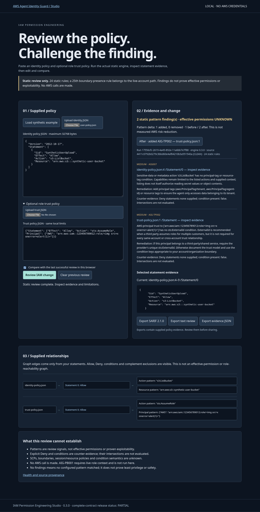

# AWS Agent Identity Guard

IAM Permission Engineering Studio helps cloud developers and security reviewers inspect a proposed IAM change without AWS access. Paste or upload an identity policy and optional role trust policy, invoke the real static scanners, inspect exact statement evidence, then edit and compare findings.

**Release decision: PARTIAL.** The local browser workflow functions within its supported structural/static scope. Effective permissions, proven exploitability, authenticated multi-user hosting and deployment-specific approval remain unverified or unimplemented. Findings are review signals, not authorization decisions.

## Try the real engine in your browser

[**Open the free Colab notebook**](https://colab.research.google.com/github/poojakira/aws-agent-identity-guard/blob/codex/local-workbench-20261116/notebooks/try_product.ipynb) · [Inspect the notebook source](notebooks/try_product.ipynb) · [Detailed architecture diagrams](docs/ARCHITECTURE.md)

Sign in with a Google account, select the **free CPU runtime**, and run the setup and scenario cells. Change the scenario and run again to inspect freshly computed evidence and hashes. This is an inline, guided synthetic-data demonstration of the actual repository engine, **not a publicly hosted copy of the full web application**. No API key, paid plan, GPU, Drive mount, tunnel or cloud-resource creation is used by the notebook. Free Colab availability/limits are outside this repository's control.

The setup resolves the reviewed branch to one exact SHA, checks it out and installs only minimal demo dependencies in a separate temporary environment. It starts no web server. [Testing access and limitations](docs/TRY_IT.md) distinguishes locally executed notebook checks from Colab-hosted runtime verification. Use the full local UI below for its broader supported input and workflow.

## Architecture

[](docs/architecture/overview.svg)

Open the [full-size overview](docs/architecture/overview.svg) or [zoomable HTML viewer](docs/index.html). See the [detailed architecture and execution sequences](docs/ARCHITECTURE.md) for exact code symbols, controls, limits, errors, cleanup, evidence and the separate guided notebook scope.

## Start locally

Prerequisites: Python 3.10 or newer, pip and a browser. The static engine/studio has no third-party runtime dependency, AWS credential requirement or paid-service requirement. Initial installation may download packaging tools.

```sh
python -m venv .venv
. .venv/bin/activate
python -m pip install -e .
python -m aws_agent_identity_guard.studio
```

On Windows PowerShell, activate with `.venv\Scripts\Activate.ps1`. Open **http://127.0.0.1:8762**. To avoid an occupied port, use `python -m aws_agent_identity_guard.studio --port 8765` and open the printed address. The service binds only to IPv4 loopback and accepts its exact origin. Stop with Ctrl+C; do not expose it through a tunnel or reverse proxy.

## Complete a real policy review

1. Select **Load synthetic example**, or paste/upload a permitted identity policy. Keep credentials and secrets out of inputs.
2. Optionally expand **Optional role trust policy** and supply trust JSON. Select **Review IAM change**.
3. Select a finding to inspect its exact statement, source lines, rationale, remediation and supplied counter-context. The graph displays supplied statements and patterns only.
4. Edit the policy and review again. Added/removed pattern findings link to After/Before evidence; the delta is not measured risk reduction.
5. Export **SARIF 2.1.0**, a text review or evidence JSON. Exports contain supplied policy context, so review them before sharing. Clearing the previous review or closing the tab removes the in-memory comparison reference.



This screenshot belongs to tested implementation source `970d1e1e3d5e65e91bd45fe16bb59725eec7b1dc`; its immutable evidence archive is not a software release.

## Supported scope and uncertainty

- **24 static rules:** AIG001–AIG021 and AIG-TP001–003. A separate live-context AIG-PB001 checks missing boundary presence on flagged roles; it does not run from supplied policy alone. The product-wide inventory is 25 IDs, not 25 static rules.
- Canonical identity/trust scanners, bounded structural parsing, exact source spans, input/configuration/rule hashes and CLEAN/DIRTY/UNKNOWN provenance.
- Upload/editor review, explicit errors, supplied-only graph, before/after comparison, safely rendered findings and schema-checked SARIF/text/JSON exports.
- Separate CLI, optional read-only AWS collection, rule-based remediation templates and validation adapters retain their own prerequisites. The studio does not invoke AWS.

Deny statements and conditions are visible context; the scanner does not evaluate their intersections with Allow, SCPs, boundaries, sessions, resource policies or service-specific applicability. Effective permissions remain **UNKNOWN**. Some canonical messages describe potential capabilities broadly; validate the actual listed actions and all applicable context before concluding a grant or exploit. No finding does not prove least privilege or safety. Boundary presence does not prove effectiveness.

Each studio document is limited to 32,768 UTF-8 bytes, depth 16 and 32 statements; action/resource/principal lists have at most 64 values. The backend retains no policy database. Inputs exist in browser/backend memory; explicit exports persist on the operator's disk. The trusted host/operator remain part of the boundary.

## Verification and release scope

**LOCAL ONLY, historical snapshot.** The archived suite at `abe1c0a1e5953b18eae762a5c41f400ff677adb2` recorded 272 passed, 0 failed, 3 skipped, 77.15% statement coverage. The archive was generated on November 19, 2026 UTC and lists the exact commands, tooling, test window, skips and artifact hashes. Use its source SHA when citing the results. [Manifest](https://raw.githubusercontent.com/poojakira/aws-agent-identity-guard/a396433a4070a0ddc68aa83f9b1093e87fc3224f/release-evidence/manifest.json) · [Assessment](https://github.com/poojakira/aws-agent-identity-guard/blob/a396433a4070a0ddc68aa83f9b1093e87fc3224f/release-evidence/RELEASE_ASSESSMENT.md)

The studio evaluates supplied JSON and context offline. Complete AWS authorization depends on policy intersections and request context, including organization policies, session policies, resource policies and permission boundaries. [Draft review](https://github.com/poojakira/aws-agent-identity-guard/pull/75)

## Develop and verify

The direct/transitive verification snapshot targets Linux x86_64/Python 3.12; wheel hashes are not locked. Runtime supports Python 3.10+. Fetch the official schema only for verification, not normal operation:

```sh
python -m pip install -r requirements-studio-test.txt
python -m pip install -e .
curl -fLS https://docs.oasis-open.org/sarif/sarif/v2.1.0/errata01/os/schemas/sarif-schema-2.1.0.json -o /tmp/iam-sarif-schema.json
echo 'c3b4bb2d6093897483348925aaa73af03b3e3f4bd4ca38cef26dcb4212a2682e  /tmp/iam-sarif-schema.json' | sha256sum -c -
python scripts/studio_verify.py --output /tmp/iam-studio-evidence --schema /tmp/iam-sarif-schema.json --chromium /usr/bin/chromium
```

The verifier needs a clean checkout and an existing Chromium at the chosen path. It runs complete regression, lint/format/type/security, actual browser/export/schema checks, build, dependency audit and the existing synthetic performance gate, then records actual commands, UTC times, outcomes and hashes outside the checkout. Existing gates remain unchanged. For focused development use `SARIF_SCHEMA_PATH=/tmp/iam-sarif-schema.json python -m pytest tests/test_studio.py`; without the schema prerequisite that schema check is skipped explicitly.

## Documentation index

| Task | Guide |
|---|---|
| Browser product, architecture, API, user/developer workflow and limits | [Studio](docs/STUDIO.md) |
| CLI, optional live collection, remediation, failures and rollback | [Runbook](RUNBOOK.md) |
| Threat boundaries and vulnerability reporting | [Threat model](THREAT_MODEL.md), [security](SECURITY.md) |
| Evidence, historical metrics, branch/release state | [Evidence](docs/EVIDENCE.md), [source-scoped metrics](VERIFIED_METRICS.md), [release gates](PRODUCTION.md) |
| Optional AWS trust/configuration and n8n template | [AWS architecture](docs/aws-architecture.md), [controls](docs/aws-security-controls.md), [n8n](integrations/N8N_WORKFLOW.md) |
| Contribution terms and documentation audit | [Contributing](CONTRIBUTING.md), [audit ledger](docs/DOCUMENTATION_AUDIT.md) |

Historical records retain their original sources/dates; documentary review does not establish field accuracy, live account coverage or operational approval. Main remains unchanged; active/unique branches are preserved. See the exact completed cleanup and recovery references in the evidence guide.

## Selected branches and recovery

Only `main` and `codex/local-workbench-20261116` remain as remote branches. This cleanup retired 5 additional branches after preserving their exact tips in `archive/selected-20261118/*` annotated recovery tags and a verified private Git bundle. Unmerged/dependency changes were **not merged or certified** by retiring their branches. Existing release/deployment source references are preserved separately. Main was not rewritten or merged.

See [branch policy and restore procedure](docs/BRANCHES.md) and the generated [branch-cleanup evidence](https://github.com/poojakira/aws-agent-identity-guard/blob/a396433a4070a0ddc68aa83f9b1093e87fc3224f/release-evidence/manifest.json). Bots or collaborators may create later branches; the published report records the actual verification time rather than promising permanent branch counts.
