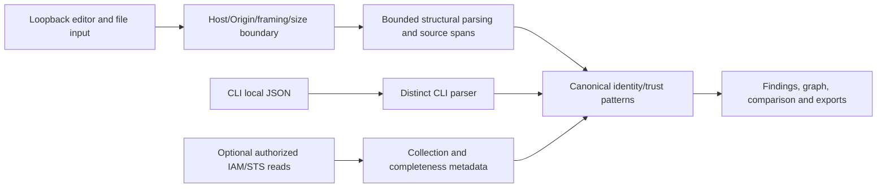

# Threat model

## Assets, actors and surfaces

Assets include policy privacy, accurate source-linked findings, comparison/export integrity, operator host, optional AWS credentials and retained reports. The local operator/host are trusted; supplied JSON, file contents, browser-origin requests and optional AWS responses are not inherently trustworthy. Policy reports can contain sensitive organizational context.

The studio has no AWS client, database, external telemetry or multi-user authentication. The CLI reads the selected identity-policy file and can write requested reports. Optional live collection uses the operator's SDK credentials; it is not a continuously running account monitor. An integrating CI/operator decides what to do with findings.

## Threat/control mapping

| Threat | Implemented control and source/test relationship | Residual boundary |
|---|---|---|
| Malformed, duplicate or oversized studio input | `studio.analysis.Document` strict bounds/spans and HTTP framing in `studio.__main__`; `tests/test_studio.py` | Not a complete AWS language validator, general CPU sandbox or equivalent CLI size boundary |
| Cross-site local request / DNS rebinding | Exact loopback peer/Host/Origin, fixed routes and CSP; studio boundary tests | Another local process/compromised OS can access loopback; no authenticated tenant boundary |
| Untrusted HTML or stale evidence | Text rendering, revision/cancellation guards and exact source evidence; browser upload/edit/export regressions | Trusted browser/host required; explicit downloads persist |
| Unsupported authorization inference | Effective permissions UNKNOWN, Deny/conditions shown, static versus live inventory separated | Pattern wording can be broad; complete intersections/applicability and exploitability are not solved |
| Comparison misread as risk reduction | Stable finding fingerprints and Before/After source mapping | Position/message changes can create deltas without permission changes; no operational impact percentage |
| Partial live scan appears clean | `live_scanner.py` errors/cap/completeness fields; CLI `--enforce`; live/error regression tests | Operator must use enforcement and inspect completeness; no complete inherited/group/resource-policy evaluation |
| Excessive scanner authority | Collector invokes read-only IAM/STS APIs; approved credentials/configuration supplied externally | Least privilege and identity trust must be reviewed in the target account; code does not constrain stolen credentials independently |
| Unsafe suggested fix | Rule-based templates are printed, not applied; generation timestamps can vary | Syntax/help wording is not a validated deployment; workload/resource/condition review remains external |
| Artifact tampering or disclosure | Source/input/rule hashes and schema-valid exports; operator-controlled CI storage | Hashes are not signed, an attacker can rewrite reports, and policy/ARN data may be sensitive |
| Dependency/workflow substitution | Audits, direct tool snapshot, pinned checked-in Actions and least-required workflow permissions | Audit databases/pins are partial controls, not cryptographic build or vulnerability-free guarantees |

## Separate trust examples

The Terraform module implements **account-principal `sts:AssumeRole` plus ExternalId**, not a GitHub OIDC provider. OIDC federation requires its own approved provider/audience/subject trust and uses `AssumeRoleWithWebIdentity`, whose API has no ExternalId parameter. The delegated-credentials example is mocked and includes a client-side ExternalId comparison; its tests do not establish real STS condition enforcement. Do not deploy that teaching helper's generated trust policy unchanged. See [AWS architecture](docs/aws-architecture.md) and [the demo boundary](examples/delegated_credentials/README.md).

## Required further evidence

Full effective-IAM evaluation, representative accuracy studies, live account completeness, authenticated public hosting, external security/privacy/operational approval, complete supply-chain/build provenance and environment-specific recovery remain absent or unverified. No independent source-scoped test result is inherited by a later commit; use [EVIDENCE.md](docs/EVIDENCE.md). The trusted operator controls retention, permissions and dissemination of inputs/reports. This document assigns no universal likelihood score or accepted organizational risk on someone else's behalf.
