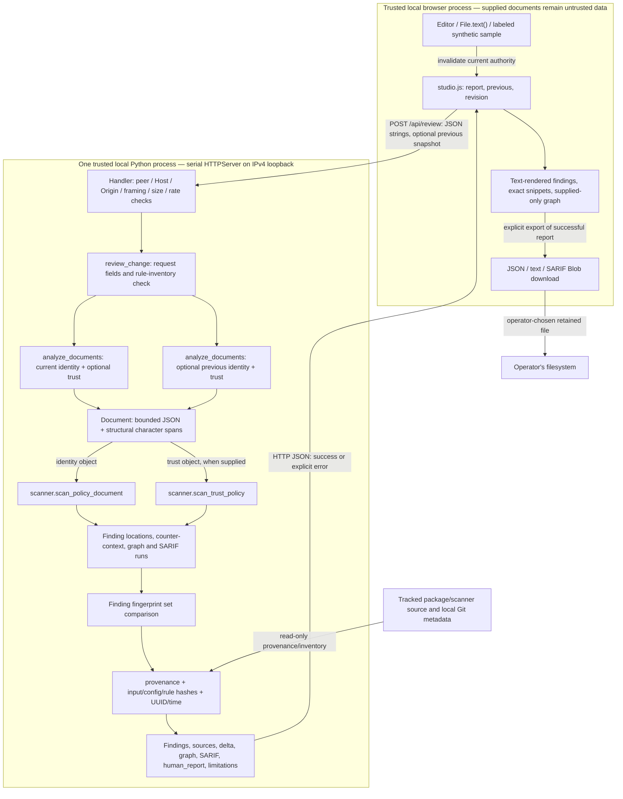
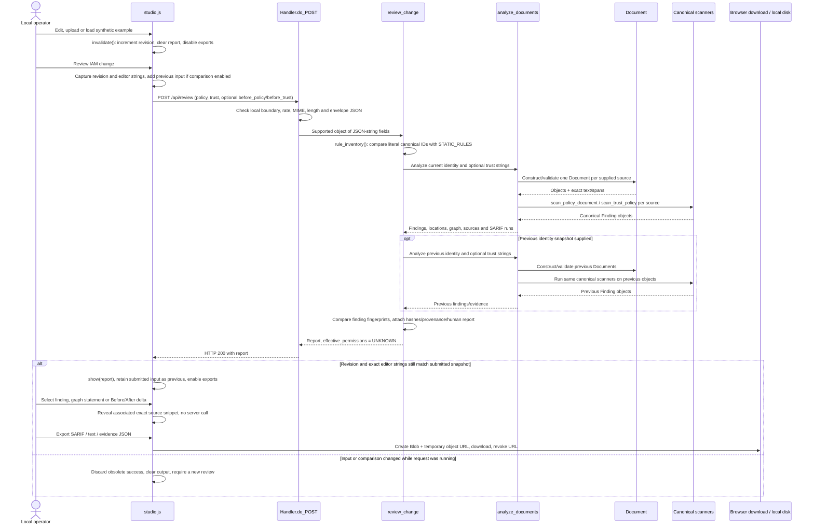
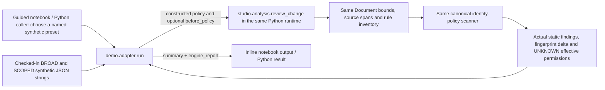

# Architecture: IAM policy review and evidence

This document describes the checked-in local IAM Permission Engineering Studio. It follows the actual code path from supplied JSON to canonical scanner findings, comparison, graph and downloads. It is an architecture reference, not a claim that every acceptance gate has passed. Exact-source execution results belong in [EVIDENCE.md](EVIDENCE.md).

Software version is 0.3.0. The local studio uses 24 static rule IDs: AIG001–AIG021 and AIG-TP001–003. AIG-PB001 belongs to optional live-role collection and is not executed by this path. Findings are static review signals; effective permissions and exploitability remain **UNKNOWN**.

## Components and trust boundaries

The Python process trusts its installed source, interpreter, OS and local operator. Input text is not executed and does not select a file path, URL, executable or AWS identity. Host/Origin checks constrain browser access; they do not authenticate another process on the same host. A process able to forge local requests or alter package/browser memory is outside the trusted single-operator boundary. There is no account/tenant store, background job queue or database in the local studio.

The static CLI and optional Boto3 collector are separate entry points; the browser does not call them. The CLI has a different input-validation contract. The collector makes authorized IAM/STS reads and can add boundary-presence context, but does not supply effective-permission evaluation to this diagram. See [the runbook](../RUNBOOK.md) and [AWS integration architecture](aws-architecture.md).

## Actual review, comparison and export sequence

The previous successful input is browser memory, not server history. It is sent again as explicit strings for comparison. Editing current input invalidates current output but preserves that previous input until **Clear previous review** or page/tab lifecycle removes the JavaScript state. A failed review does not become the new baseline. A normal reload also recreates the page state.

An export serializes the already accepted `report.sarif`, `report.human_report` or full report. There is **no export endpoint**, backend export job or durable report row. The browser enables export controls only after `show(data)` accepts a successful current result. Schema validation is an executable verification gate; the running server constructs SARIF without calling the official schema service or AWS.

## Source symbols and responsibilities

Paths below are relative to the repository root. Event-handler descriptions identify the actual DOM control IDs because those JavaScript callbacks are anonymous.

| Component / symbol | Source | Responsibility and limit |
|---|---|---|
| `create_server`, `main` | [studio/__main__.py](../src/aws_agent_identity_guard/studio/__main__.py) | Bind `127.0.0.1`, default port 8762 or `--port`; run one serial HTTP server |
| `StudioServer.hits` | [studio/__main__.py](../src/aws_agent_identity_guard/studio/__main__.py) | Shared in-process review-request timestamps; no per-user or distributed quota |
| `Handler.boundary`, `setup`, `respond` | [studio/__main__.py](../src/aws_agent_identity_guard/studio/__main__.py) | Peer/Host/Origin checks, socket timeout, response headers and sanitized local API output |
| `Handler.do_GET`, `do_POST`, `unique_pairs` | [studio/__main__.py](../src/aws_agent_identity_guard/studio/__main__.py) | Fixed routes, envelope framing/duplicate-field parsing and conversion of errors to responses |
| `InputError`, `Document.__init__`, `parse`, `validate`, `strings` | [studio/analysis.py](../src/aws_agent_identity_guard/studio/analysis.py) | Supported bounded policy structure, duplicate/non-finite rejection and structural span collection |
| `Document.location` | [studio/analysis.py](../src/aws_agent_identity_guard/studio/analysis.py) | Exact source name, JSON pointer, one-based line range and snippet for a statement or whole policy |
| `rule_inventory`, `STATIC_RULES` | [studio/analysis.py](../src/aws_agent_identity_guard/studio/analysis.py) | Check that literal IDs in canonical scanner source match the advertised 24 static IDs; not an accuracy test |
| `analyze_documents` | [studio/analysis.py](../src/aws_agent_identity_guard/studio/analysis.py) | Run canonical scanners and assemble source evidence, counter-context, graph and SARIF |
| `review_change` | [studio/analysis.py](../src/aws_agent_identity_guard/studio/analysis.py) | Validate request fields, analyze both snapshots when supplied, compare finding sets and attach report metadata |
| `scan_policy_document`, `scan_trust_policy`, `Finding` | [scanner.py](../src/aws_agent_identity_guard/scanner.py) | Canonical identity/trust pattern rules and finding data; not a complete IAM authorization solver |
| `_build_sarif` | [cli.py](../src/aws_agent_identity_guard/cli.py) | Canonical SARIF structure; studio adds regions, pointers, scope, counter-context and run metadata |
| `provenance`, `checksum` | [studio/analysis.py](../src/aws_agent_identity_guard/studio/analysis.py) | Local source/rule hashes and guarded Git metadata; unsigned byte correspondence |
| `invalidate`, `emptyResults`, `show`, `select` | [studio.js](../src/aws_agent_identity_guard/studio/studio.js) | Current-result authority, text rendering and source selection in browser memory |
| `policy-file` / `trust-file` change handlers | [studio.js](../src/aws_agent_identity_guard/studio/studio.js) | Bound file size, revision-guard asynchronous `File.text()` and invalidate again before assigning loaded text |
| `review` click handler | [studio.js](../src/aws_agent_identity_guard/studio/studio.js) | Capture input snapshot, fetch real API, reject stale completion and update baseline only on accepted success |
| `download`; `sarif`, `human`, `json` handlers | [studio.js](../src/aws_agent_identity_guard/studio/studio.js) | Explicit local Blob downloads from current accepted report; no new analysis or remote upload |

## Exact source evidence, rules and graph

`Document.parse` records **character offsets into the decoded Python string**, indexed by structural paths. It does not search for the text “Statement,” and it does not advertise UTF-8 byte offsets or source columns. `Document.location` returns `identity-policy.json` or `trust-policy.json`, a structural pointer, one-based `startLine`/`endLine`, and the exact text slice. A single-object `Statement` uses `/Statement`; an array statement uses `/Statement/N`. Policy-wide combination findings use the whole document, not an invented contributing statement.

Each parsed document is routed to the appropriate canonical scanner. Identity and trust findings are adapted independently into SARIF runs. The studio adds source regions and logical locations to the canonical writer's results and returns source text/hashes alongside those runs. Deny statement indices and condition-presence flags are **counter-context only**: their inclusion does not establish that a Deny applies, that a condition is sufficient, or that a flagged action is effectively allowed.

The graph is built only from supplied documents, statements and `Action`, `NotAction`, `Resource`, `NotResource` or `Principal` fields. Edges record the statement effect and whether conditions are present; complements are labeled exclusions. It is not an account entitlement graph, role reachability calculation or resource inventory. Selecting a node reveals the same statement location; it does not query AWS.

A finding fingerprint hashes rule ID, source kind, statement index, severity and message. Set comparison determines added/removed findings. Moving a statement or changing a message can create a delta without changed permissions. Conversely, changing resource/condition text without changing those fingerprint fields can leave the finding set unchanged. Use the exact source/input hashes and snippets as well; the delta is not a complete policy diff or measured risk reduction.

## Input, resource and error boundaries

| Boundary | Actual local-studio contract |
|---|---|
| Routes | `GET /`, `/studio.js`, `/studio.css`, `/health`; `POST /api/review` only |
| Host and peer | IPv4 loopback peer; exactly one `Host` matching `127.0.0.1:PORT`; at most one Origin, matching that exact origin when present |
| Envelope | Exact `application/json`, no Transfer-Encoding, exactly one Content-Length, 1–196,608 bytes; duplicate envelope keys rejected |
| Request fields | Required `policy`; optional `trust`, `before_policy`, `before_trust`; all strings; unknown fields rejected; non-empty previous trust requires previous identity |
| Per document | Non-empty object, at most 32,768 UTF-8 bytes, nesting at most 16, supported version/Id/Statement fields |
| Statement/list limits | 1–32 statement objects; explicit Allow/Deny; action/resource/principal lists contain 1–64 non-empty strings; individual strings/keys at most 4,096 characters |
| Supported identity/trust forms | Identity supports exactly one Action/NotAction and Resource/NotResource, with no Principal; trust supports Action and supported Principal, with implicit role resource; unsupported structures fail explicitly |
| Conditions | Bounded operator/key/scalar-or-list structure; not complete service-specific IAM condition semantics |
| Scheduling and availability | One request at a time; 30 review attempts/minute in one process; five-second socket timeout; no worker sandbox, total analysis deadline or distributed availability guarantee |

A five-second socket timeout is **not a total wall-clock receive/analysis deadline**. The rate budget is shared local process state, counts review attempts after route/boundary checks and resets with the process. Input bounds limit work but do not prove general hostile-input isolation.

| Response | Source behavior and UI authority |
|---|---|
| 200 | Report constructed successfully; it can contain high/critical pattern findings and still says effective permissions UNKNOWN |
| 400 | Invalid envelope, unsupported policy structure/type, malformed/duplicate/non-finite input or incomplete body |
| 403 | Peer/Host/Origin boundary rejected |
| 404 | Unsupported route |
| 413 | Declared review body outside supported size |
| 415 | Unsupported content type or Transfer-Encoding |
| 429 | Shared review-request budget reached |
| 500 | Internal inventory/engine failure; sanitized failure message, no successful review established |

These are handler response paths, not a promise that every network disconnect or socket failure yields a complete JSON error response. The UI clears current report authority before a review and on errors; a failed or obsolete result does not leave a downloadable “success.”

## Asynchronous authority and failure recovery

`revision` is incremented when input, file selection, sample, comparison choice or clear action invalidates a report. Review start captures both revision and exact editor strings. On completion, the browser checks all of them before calling `show`; an obsolete success is discarded. This is logical invalidation, not cancellation of the synchronous server analysis.

File loading has a separate await point. A change invalidates current output, captures a revision and awaits `File.text()`. It discards an obsolete read if a later edit/selection won. Even if the revision still matches, it invalidates **again** before assigning file text because a review may have completed while the file was being read. That second invalidation prevents old export authority from describing newly loaded editor content.

A successful review stores only the submitted policy/trust strings as the next comparison baseline. **Clear previous review** invalidates current output and removes that baseline. There is no backend history to recover after process/page loss. Refresh/reselect inputs and rerun when current authority is unavailable; do not reinterpret an old saved report as the result of new input.

## Privacy, provenance and reproducibility

The backend does not persist supplied policy input/results or make AWS calls in this path. The browser keeps editor text, a successful report and a previous comparison snapshot in memory. Exports can include full current policy text, account/role/resource names, condition values, graph labels and removed-finding snippets from the previous input. Explicit downloads remain on disk wherever the operator saves them; no encryption, automatic deletion or secure memory erasure is promised.

HTTP request logging is suppressed by this handler. That does not establish the privacy of the OS/browser, a separately configured proxy or an operator's retained artifacts. The local studio is not intended for public proxying; its restricted routes and CSP do not provide multi-user identity or policy confidentiality against other host processes.

Provenance includes software version, static rule IDs, a SHA-256 of canonical scanner file bytes, input/configuration hashes, a run UUID and UTC time. The per-source hash is over the exact UTF-8 input text; the envelope hash uses sorted-key JSON serialization of the supplied string fields, and configuration hash covers the adapter's declared mode/limits/comparison flag. Rule-file hashing does not hash every dependency or constitute a signed attestation.

Git SHA/status is reported only when the analysis module is the tracked expected source path under the exact Git top-level. Otherwise source is UNKNOWN, including ordinary installed wheels under an unrelated repository. CLEAN means the checked checkout had no porcelain changes at inspection time; it is not code authenticity or build provenance. Run IDs/times vary, so complete report bytes need not repeat even when static input/rules/configuration match. [EVIDENCE.md](EVIDENCE.md) identifies the exact candidates and actual executed results.

## Controls this architecture does not provide

No effective-IAM evaluation across Deny, SCP, boundary, session, resource and trust intersections; no verified caller identity, complete live account/role inventory, field efficacy or proven exploit chain; no network/public multi-tenant isolation; no hard worker sandbox, total detector deadline, externally anchored audit log, durable review database or signed report; and no automatic AWS remediation. Those absent controls are not implied by a graph, a hash, finding severity, HTTP success or a green schema check.

## Separate inline synthetic notebook surface

The source also contains `demo/adapter.py`, a separate guided synthetic adapter intended for the inline notebook entry point `notebooks/try_product.ipynb`. It calls the same canonical analysis path in a notebook/Python process; it does **not** publish the local HTTP studio, start another HTTP server, accept visitor policy uploads or configure public hosting. This architecture pass read the adapter before the notebook file was available. Notebook integration, try-link availability and actual Colab execution therefore need their own validation; none is claimed here.

`demo.adapter.SPEC` declares three scenarios: `broad`, `scoped` and `compare`. `BROAD` is an identity policy containing wildcard Action/Resource; `SCOPED` is a synthetic S3 object-read policy. `run` constructs the request from those checked-in strings and invokes `review_change`. The comparison preset supplies the broad policy as `before_policy` and the scoped policy as current input. It is a real canonical finding-set comparison over fixed fixtures, not a recorded result or arbitrary visitor-policy diff. Trust-policy UI/analysis and the full upload/editor workflow remain features of the separate local studio.

The direct adapter path inherits `review_change`/`Document` validation and provenance; it does not pass through the local HTTP handler's Host/Origin, framing, request-rate or socket checks. Those HTTP controls must not be represented as notebook protections. Notebook/kernel access, package installation, provider authentication, compute availability and runtime permissions are separate platform concerns. The scanner's synthetic analysis requires no AWS account, provider API key or AWS service call; that does not promise anonymous notebook-platform access or guaranteed hosted compute.

The adapter returns a Python mapping containing a short summary and the actual engine report. The notebook is responsible for presenting that mapping and any explicit download behavior. Git source metadata can be UNKNOWN outside the exact tracked editable source root, and unsigned report hashes are not deployment/build attestations. Do not infer Colab execution, public deployment, data isolation, arbitrary-input safety or production approval from an adapter file or a notebook link alone.
