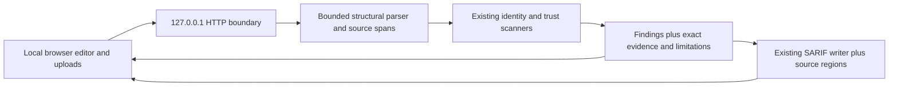

# IAM Permission Engineering Studio

## Product requirements and supported workflow

The user is a cloud developer or security reviewer examining an IAM change without AWS access. The smallest useful workflow is identity JSON plus optional trust JSON → strict bounded structural parsing → canonical static scanners → statement evidence and supplied-only graph → edit/rescan against the previous input → SARIF/text/evidence export. The frontend performs no detection. Synthetic example input is explicitly labeled; uploaded input reaches the same engine.

The product has 24 static rules (AIG001–AIG021, AIG-TP001–003). The additional product-wide rule AIG-PB001 lives in the live scanner and checks boundary presence using role context; it is not run here. Presence does not prove boundary effectiveness. No AWS client, account credentials, paid API or external service is used in this local application.

Acceptance: a user can paste or upload a supported policy, see actual findings at exact statement lines, inspect conditions and supplied Deny statements, edit and rescan, navigate added/removed finding evidence, inspect a graph derived from supplied statements, and download standards-validated SARIF 2.1.0 and a text review. A successful HTTP request is not a claim about effective permissions. Engine failure produces an explicit error and removes stale output.

## Architecture and ADR



Entry points are `studio.__main__.create_server`, `studio.analysis.Document`, and `studio.analysis.review_change`. `scan_policy_document` and `scan_trust_policy` remain the engine of record. `_build_sarif` supplies the canonical SARIF structure; the adapter adds verified source regions and run metadata. A parser records structural spans, so text containing the word Statement does not confuse evidence locations. Policy-level combination findings link to the whole document rather than inventing a contributing line. Source text and location come from the exact supplied bytes.

ADR: a serial stdlib HTTP server keeps the static product free of runtime dependencies. One request runs at a time; bounded input limits engine work and memory. There is no job queue or background worker. The browser retains the previous successful input only in memory and submits it explicitly for comparison. No input or result is persisted by the backend. No shared infrastructure or other security product is required.

## Semantics and limitations

Findings are static patterns. The scanner does not solve the IAM authorization model or prove an exploit chain. Explicit Deny statements and conditions remain visible as review context; their intersections with flagged Allow statements are **NOT IMPLEMENTED**. Supplied Deny indices are not a claim that those Deny statements apply to a finding. Trust conditions are shown and the canonical structural condition checks run, but their service-specific sufficiency is not established.

SCPs, permissions boundaries, session/resource policies, caller identity, organizational context and action/resource applicability may alter effective access. Those inputs are outside this studio's supported context and effective permissions remain UNKNOWN. No finding does not establish safety or least privilege. The delta compares rule/severity/message/statement-position fingerprints; it is not a quantified risk reduction. Moving a statement or changing a message can produce an added/removed pair.

The graph contains only supplied documents, statements, action/resource/principal patterns and condition-presence metadata. NotAction and NotResource are labeled exclusions. No role identity, reachability, live permission, or graph edge is inferred from an absent resource inventory. Long labels wrap; selecting a statement reveals its full exact source.

## Input contract and API

The app accepts bounded UTF-8 IAM identity JSON and optional role trust JSON. This is supported structural validation, **not a complete AWS policy-language validator**. JSON duplicates, non-finite numbers, depth above 16, documents above 32768 bytes, more than 32 statements, non-object statements, missing/invalid Effect, incompatible Action/NotAction or Resource/NotResource fields, unknown statement fields and malformed condition objects fail closed. Each action/resource/principal list is limited to 64 non-empty strings; individual strings to 4096 characters. Trust input supports Action and Principal with the implicit role resource; unsupported NotAction/NotPrincipal/resource-policy structures are rejected explicitly.

`GET /` serves the browser. `GET /health` reports software version 0.3.0, actual rule inventory/hash and source provenance. Only a tracked editable package at its exact Git top-level reports a Git SHA with CLEAN/DIRTY status. Installed distributions report UNKNOWN, including when installed under another repository.

`POST /api/review` requires exactly `Content-Type: application/json`, one declared Content-Length, no Transfer-Encoding, and a body of 1–196608 bytes. Fields are JSON strings: required `policy`, optional `trust`, `before_policy`, `before_trust`. Comparison requires a before identity policy. Unknown fields are rejected. No filename, filesystem path, executable, account, credential, URL or remote target is accepted.

```json
{"policy":"{\"Statement\":[{\"Effect\":\"Allow\",\"Action\":\"iam:PassRole\",\"Resource\":\"*\"}]}","trust":""}
```

Errors: 400 malformed/unsupported input, 403 Host/Origin/peer boundary, 404 route, 413 body size, 415 content framing/type, 429 rate limit, 500 engine failure with sanitized text. The UI disables exports and clears stale findings on edits and failures. It retains the prior successful input for an explicit comparison until cleared or the tab is closed.

## User guide and exports

Launch with `python -m aws_agent_identity_guard.studio`, then open http://127.0.0.1:8762. Load the synthetic example or use the file controls. Optional trust input is in a disclosure panel. Review, select a finding and read its source, message, remediation and context. Edit the identity policy, review again, then select an added or removed item; removed evidence is explicitly labeled Before. Clear previous review to begin a new comparison.

SARIF exports represent the current identity/trust analysis, with separate runs, source lines, canonical rule IDs and source/rule/configuration/input provenance. Schema verification is an executable release check against the pinned official OASIS SARIF 2.1.0 errata schema; it does not imply that OASIS validates the security interpretation. Text and JSON exports contain supplied statement evidence and may contain sensitive policy context. Review exports before sharing. No export is a live AWS validation report.

## Threat model, data lifecycle and operations

Assets: operator host, policy privacy, accurate findings/evidence and exports. Entry points: browser text/file inputs and local HTTP. Threats: hostile JSON/depth/size, ambiguous duplicate fields, cross-site requests/DNS rebinding, user-supplied HTML, false success, invented graph/context, stale evidence and cross-user disclosure.

Controls: fixed IPv4 loopback binding, exact single Host and checked Origin, bounded declared and actually read body, JSON type/depth/list/string/statement bounds, serial processing, 30 requests/minute, five-second socket timeout, no network/cloud/file-path operations from user input, fixed asset route inventory, textContent rendering, restrictive CSP, no cache and sanitized errors. Existing engine tests and new adversarial checks cover actual behavior. The local operator and host remain trusted; this is not authentication against another OS user, a multi-tenant service, or a sandbox for arbitrary code. A slow local client can occupy the serial service until the timeout. Power/process failure loses in-memory comparisons; there is no durable recovery promise.

Inputs remain in browser/backend process memory for processing and are not written by the studio. Downloaded exports remain wherever the operator saves them. No localStorage, external fonts, analytics or third-party API is used. Browser tab closure or Clear previous review removes the comparison reference. Normal shutdown is Ctrl+C; no database, migration or backup is required. Port can change with `--port NUMBER`; bind address cannot. Never expose this through a public tunnel or proxy. Rollback uses a prior reviewed checkout after preserving local edits; no history rewrite is required.

## Security autopsy: stale asynchronous evidence

A delayed actual backend response initially replaced the cleared evidence after an operator edited the policy during a scan. That could pair old findings with a newer editor. The browser now tracks input/configuration revisions and discards responses when the submitted snapshot is no longer current. The real-browser regression delays an actual engine response, changes the editor, then requires exports to remain disabled and an explicit rerun message. No engine result is mocked and no assertion is relaxed.

## Development, verification and remaining gates

Use Python 3.10+ for runtime; the pinned verification snapshot targets Linux x86_64/Python 3.12. Install `requirements-studio-test.txt` plus `-e .`. Existing CLI/live paths remain available with their own prerequisites and tests. No live credentials should be supplied to run the studio. The historical three credential-dependent validation tests are skips, not successful AWS checks.

`scripts/studio_verify.py` requires a clean source and out-of-tree output. It executes lint/format, the full regression with coverage, focused studio typing, medium/high Bandit, real browser/upload/edit/delta/download/schema tests, package build, installed dependency audit and the existing 500-policy performance gate. It records commands, actual UTC times, dependencies, source status, test pass/fail/skip, coverage, results and SHA256 artifacts. Existing minimum collection and performance gates remain. The official schema must be fetched and checksum-verified as in the workflow. Local Chromium is `/usr/bin/chromium`; CI installs the tested Playwright browser. `actionlint` validates the workflow's GitHub schema and contexts, not merely YAML syntax.

Complete-contract status remains PARTIAL pending independent candidate review, full legacy-document semantic reconciliation, remote CI/protection visibility, branch consolidation and environment-specific release/operational approval. Complete effective-IAM evaluation, live role graph/context and a securely authenticated public deployment are NOT IMPLEMENTED in this local flow. No tag, cloud infrastructure or production release is created by adding the studio.
