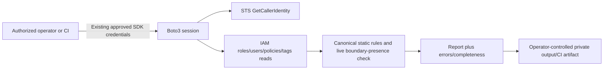

# AWS integration architecture

## Actual product and optional boundaries

The local studio and static CLI run without AWS. Their [architecture](STUDIO.md#architecture-and-adr) is input → structural/static review → evidence, not an account service. The optional collector uses Boto3 IAM/STS reads and invokes the same canonical patterns. No AWS deployment or cloud command was executed by this documentation pass.

The ordinary collector does not stream CloudWatch logs, query CloudTrail events, publish ASFF/Security Hub, traverse Organizations accounts, or continuously monitor requests. No complete IAM entitlement graph or authorization intersection evaluation is implemented. Region is SDK configuration; IAM is a global service. [RUNBOOK.md](../RUNBOOK.md#optional-live-collection) lists actual commands/read permissions and completeness behavior.

## Checked-in Terraform: account-principal AssumeRole

`infra/terraform/modules/scanner-iam/main.tf` declares a scanner role/policy attachment and a CloudWatch log group with retention. Its trust is an AWS account principal performing **`sts:AssumeRole` with `sts:ExternalId`**, not a GitHub OIDC provider. The module requires explicit trusted account, external identifier, environment and tags. The policy includes IAM enumeration reads and STS caller identity with wildcard resources where configured; it is not resource-wildcard-free or proof of least privilege for every environment.

`infra/terraform/environments/dev/main.tf` supplies the module and shows a **commented** S3/DynamoDB backend example. Commented backend configuration does not establish encrypted remote state or locking. Creating a log group does not wire application log shipping. Terraform configuration exists; current plan/apply, remote state, credentials, IAM effects and log delivery remain NOT VERIFIED. No `terraform apply` is required to use the studio.

Do not paste these configuration values or an apply command into a public issue. Review the actual provider version, module, trust and permissions against the target account before any independently authorized plan/application. An ExternalId is a deputy/customer discriminator, not a replacement for authentication or a universal secret credential.

## Distinct proposed OIDC federation

GitHub Actions OIDC uses an approved federated provider and **`sts:AssumeRoleWithWebIdentity`**. Restrict supported provider token claims such as audience and the exact allowed repository/ref or environment subject, under the operator's deployment policy. That STS API has **no ExternalId parameter**; do not add an `sts:ExternalId` condition as if it were supplied by this web-identity exchange.

The Terraform module above does not implement this OIDC setup. The [delegated-credentials teaching example](../examples/delegated_credentials/README.md) also must not be deployed as a real OIDC trust artifact: it deliberately compares an ExternalId-like value in local Python under moto, which does not prove AWS server-side enforcement. The repository's standard offline verification does not require a configured provider, new key or live account.

## Evidence, costs and operations

Retain full completeness/error fields and source/version/configuration information in private reports. Logs/findings can disclose policies, role names, ARNs and account relationships; choose access/retention/encryption deliberately. AWS/CI/storage API usage, quotas and cost depend on the actual account and configured services. No measured cost, operational scale, free-deployment guarantee, uptime or customer adoption is established here.

See [security controls](aws-security-controls.md), [threat model](../THREAT_MODEL.md), [release gates](../PRODUCTION.md), and [source-scoped evidence](EVIDENCE.md). Activating cloud integrations, external telemetry or report sharing requires separate explicit authorization and validation.
